# Healthcare ISP Network & Security Architecture 🏥🔐

**Capstone Project, ECPI University (CYB495)** | Role: **Network Architect / Engineer** | 4-person team (Team Echo) | Oct – Nov 2026

> Academic project based on a simulated RFP. NIH, Cedars-Sinai, and Mayo Clinic are the scenario's client organizations; this was not paid work for them.

## 📋 Overview
Our team responded to an RFP for a healthcare Internet Service Provider (ISP) that securely connects three healthcare organizations (**NIH, Cedars-Sinai, and Mayo Clinic**) to the Internet and to a centralized electronic health record (EHR) repository. The RFP required secure Internet and EHR access, redundant connectivity, 24/7 operations, and scalable, compliant infrastructure.

As Network Architect, I translated the RFP into network requirements, built and tested the design in **Cisco Packet Tracer**, and designed WAN redundancy. I then performed a **security assessment of all 17 network devices**: I identified 9 risk-rated findings mapped to **HIPAA** and **NIST CSF 2.0**, remediated 5, and validated each fix with testing.

## 🛡️ Security Assessment Highlights
| Metric | Result |
|---|---|
| Devices reviewed | 17 (routers, switches, Cisco ASA firewalls) |
| Findings | 9 (2 High, 5 Medium, 2 Low) |
| Remediated and tested | 5, including the High-rated Guest network isolation gap |
| Open, with documented fixes | 4 (device hardening, logging/NTP, port security, asset naming) |

**Key fix:** Guest Wi-Fi networks could reach other hospitals' guest networks, WAN links, and firewall links. I rebuilt the Guest ACLs at all six hospital routers and verified with ACL hit counters that guests are now blocked from clinical systems and infrastructure, while Internet access still works.

Full report: **[docs/security-assessment.md](docs/security-assessment.md)**

📓 **Project journal (5 weeks + corrections addendum):** [docs/final-project-journal.pdf](docs/final-project-journal.pdf)

## 🗺️ Network Topology (Cisco Packet Tracer)
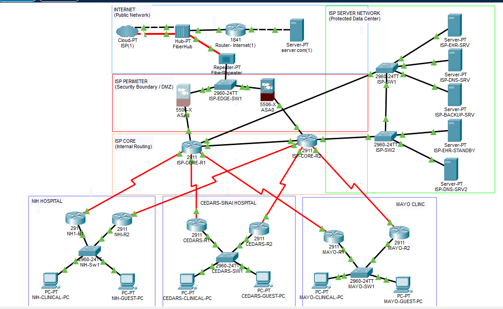

| Zone | Components |
|---|---|
| **Internet** | Simulated ISP cloud, Internet router, external web server (`server.com`) |
| **ISP perimeter** | Two Cisco ASA 5506-X firewalls (ASA1 primary, ASA0 secondary) with NAT |
| **ISP core** | Two Cisco 2911 routers (ISP-CORE-R1/R2) running OSPF and HSRP |
| **Protected server network** | EHR server, standby EHR, primary and secondary DNS, backup server |
| **Hospitals (×3)** | Two 2911 routers per site (HSRP gateway redundancy), one 2960 switch, Clinical and Guest PCs |

### Addressing and segmentation
| Network | Purpose | Addressing |
|---|---|---|
| VLAN 10 – Clinical | Staff access to EHR | 10.20.10.0/24 (NIH), 10.30.10.0/24 (Cedars-Sinai), 10.40.10.0/24 (Mayo Clinic) |
| VLAN 30 – Guest | Internet only, isolated from clinical systems | 10.20.30.0/24, 10.30.30.0/24, 10.40.30.0/24 |
| WAN links | Point-to-point serial /30s | 172.16.0.0/16 range |
| Server network | EHR, DNS, backup | 10.10.10.0/24 |

Full plan: [docs/addressing-plan.md](docs/addressing-plan.md)

## 👤 My Contributions
- Analyzed the RFP and wrote the team's **Network Requirements** section
- Built the initial Packet Tracer mock-up: WAN /30 links, VLANs 10/30, router-on-a-stick, DHCP, routing
- Verified **Guest isolation** with ACL and web-access tests across all three hospitals
- Configured and tested **OSPF + HSRP failover** at NIH
- Redesigned WAN redundancy after instructor feedback: physically diverse circuits plus 5G backup
- Performed a **security assessment** of 17 devices: 9 findings rated by risk and mapped to HIPAA and NIST CSF 2.0
- Applied and **tested the corrections** (below) in my own copy of the team file
- Validated the implementation budget and presented disaster recovery and cost planning in the final proposal

## 🔧 Remediation → Validation
Corrections applied and tested in a copy of the team's master file:

| # | Gap found | Fix applied | Result |
|---|---|---|---|
| 1 | OSPF only at NIH; static routes at Cedars-Sinai and Mayo Clinic | OSPF on all hospital routers; removed 15 conflicting static routes | ✅ Each core: **2 → 4 OSPF neighbors**; automatic failover at Cedars-Sinai |
| 2 | No backup path to the secondary firewall (ASA0) | Floating default routes (AD 20); `inspect http` on ASA0 | ✅ With ASA1's link down, traffic failed over through ASA0 |
| 3 | Guests blocked from secondary DNS; Guest ACLs too permissive | Rebuilt 6 Guest ACLs (13 entries each) | ✅ Guests blocked from EHR, other Guest networks, and WAN links; Internet works |
| 4 | DHCP only on the R1 routers | Backup DHCP pools on R2 routers (split ranges) | ✅ Client received an address from the backup router during an outage |
| 5 | No device hardening, logging, or port security | Documented (see assessment) | ⏳ Deferred so reviewers can access the devices |

Details and evidence: [tests/test-results.md](tests/test-results.md) · Commands: [docs/correction-guide.md](docs/correction-guide.md)

### Guest isolation evidence (finding F-01)
| Rebuilt Guest ACL with hit counters on new deny rules | Guest PC blocked from EHR and other Guest networks; Internet works |
|---|---|
| 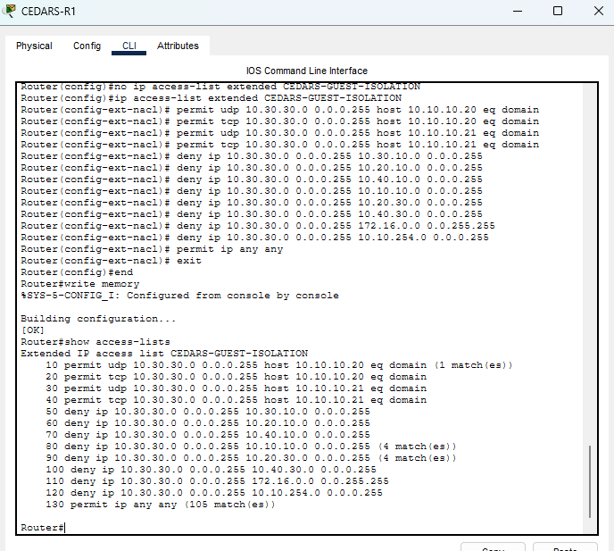 | 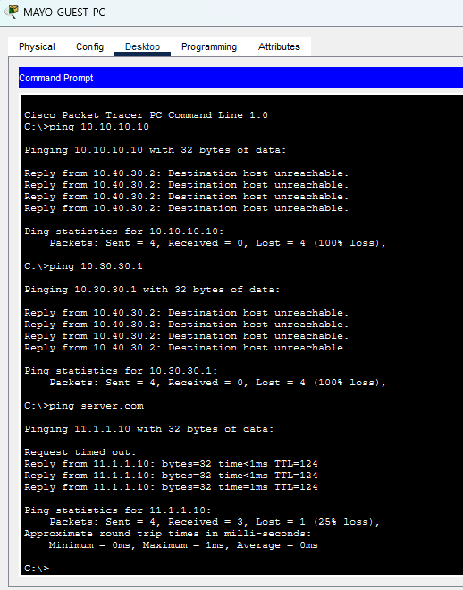 |

### Before and after: ISP-CORE-R1 OSPF neighbors
| Before (2 neighbors) | After (4 neighbors, hospital routes learned through OSPF) |
|---|---|
| 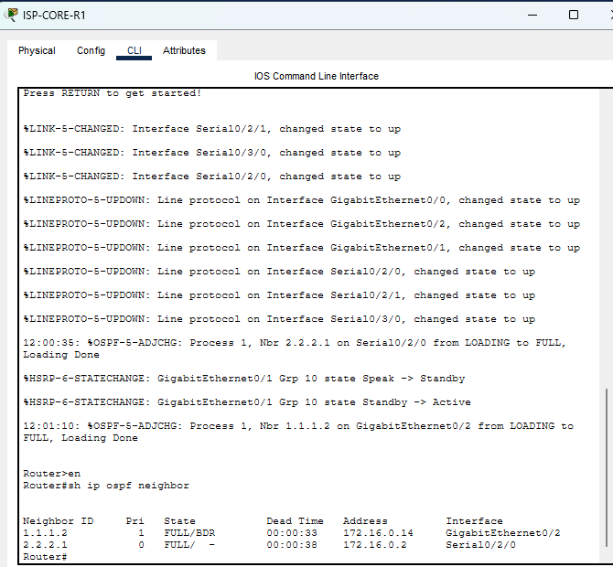 | 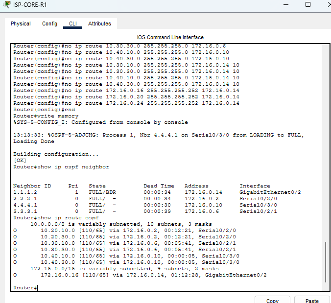 |

### Failover evidence
| Cedars-Sinai: core reroutes via ISP-CORE-R2 | Clinical PC still reaches the EHR server |
|---|---|
| 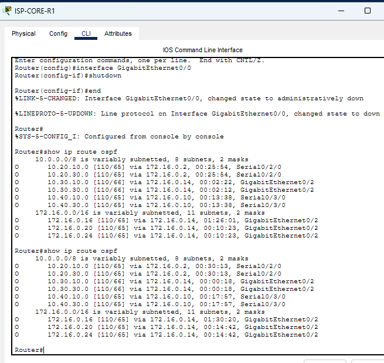 | 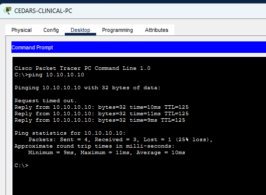 |

| ASA1 link down: floating route takes over | ASA0 translates hospital traffic |
|---|---|
| 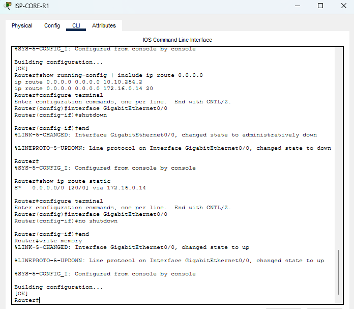 | 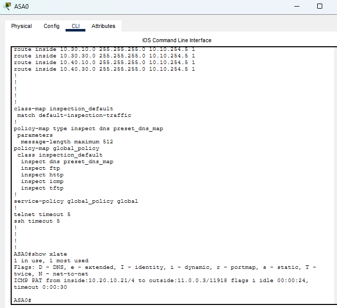 |

## 🏗️ Proposed Production Design
The simulation demonstrates routing, segmentation, and failover. The production proposal adds components that Packet Tracer cannot model:

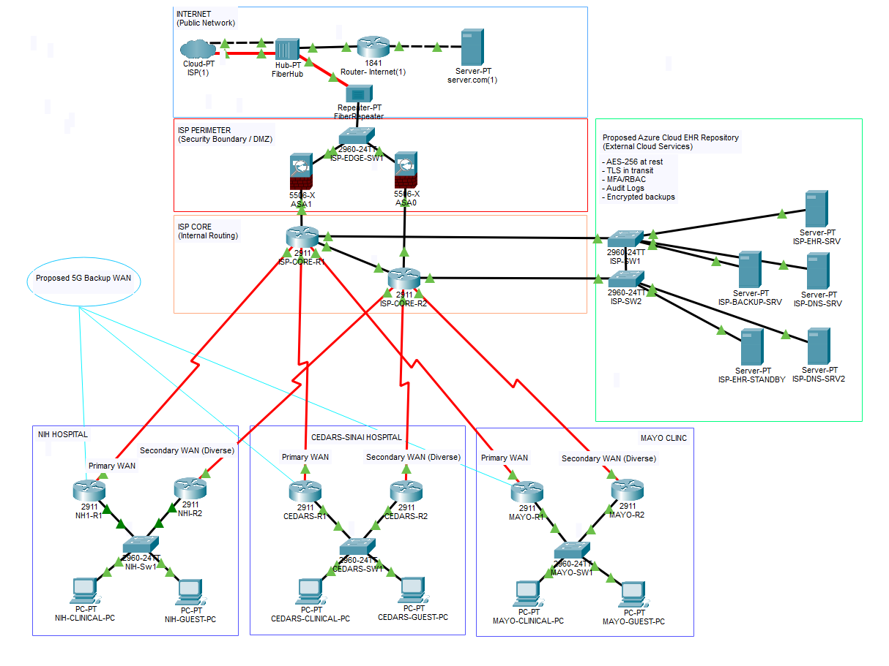

- Physically diverse primary and secondary WAN circuits per hospital, plus a **5G emergency backup**
- **Microsoft Azure** EHR repository: encryption at rest and in transit, MFA, RBAC, audit logging
- Disaster recovery targets (proposed): **4-hour RTO, 15-minute RPO**, 35-day backup retention
- Phased 12-week rollout with one hospital cutover at a time and a rollback path

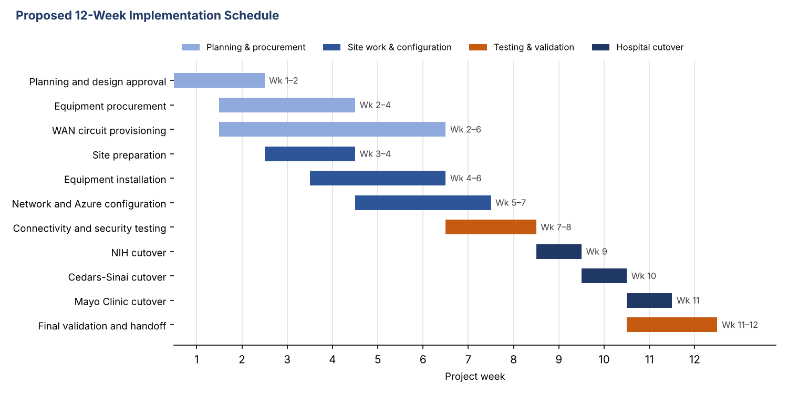

| Demonstrated in simulation | Proposed (not yet validated) |
|---|---|
| Multi-site connectivity, VLAN/ACL segmentation, OSPF/HSRP failover, ASA0 backup path, backup DHCP | Diverse WAN circuits, 5G backup, Azure EHR security and recovery, device hardening |

## 🔐 Security and Compliance
- **Segmentation:** Clinical and Guest VLANs with inbound Guest ACLs at both routers of every site
- **Availability:** OSPF + HSRP, dual firewalls, floating routes, backup DHCP
- **HIPAA context:** design aligned with Security Rule safeguards (access control, transmission security, contingency planning). *A simulation does not establish HIPAA compliance.*
- **References:** NIST SP 800-66 Rev. 2, NIST SP 800-34 Rev. 1, NIST SP 800-207, HHS HIPAA Security Rule

## 🛠️ Technologies
`Security Assessment` `Network Segmentation` `ACL` `Cisco ASA` `HIPAA` `NIST CSF 2.0` `Cisco Packet Tracer` `OSPF` `HSRP` `VLAN` `802.1Q` `DHCP` `DNS` `NAT` `WAN` `Microsoft Azure`

## 💡 Skills Demonstrated
Security assessment · Risk rating · Compliance mapping (HIPAA, NIST CSF) · Remediation and validation · Requirements analysis · Network architecture · Routing and failover · Network segmentation · Configuration auditing · Troubleshooting · Test documentation · Technical writing · Client presentation · Team collaboration

## 📁 Repository Contents
```
├── README.md
├── docs/
│   ├── security-assessment.md  # 9 risk-rated findings mapped to HIPAA and NIST CSF
│   ├── addressing-plan.md      # Networks, VLANs, devices, and IP addresses
│   ├── final-project-journal.pdf  # Weekly engineering journal (Weeks 1–5 + addendum)
│   └── correction-guide.md     # Commands used to fix the configuration gaps
├── tests/
│   └── test-results.md         # Every test with expected vs. actual results
└── images/                     # Topology and test evidence screenshots
```

## 🚧 Status
Complete (Nov 2026). Open findings: device hardening (SSH, credentials), logging/NTP, port security, asset naming.
